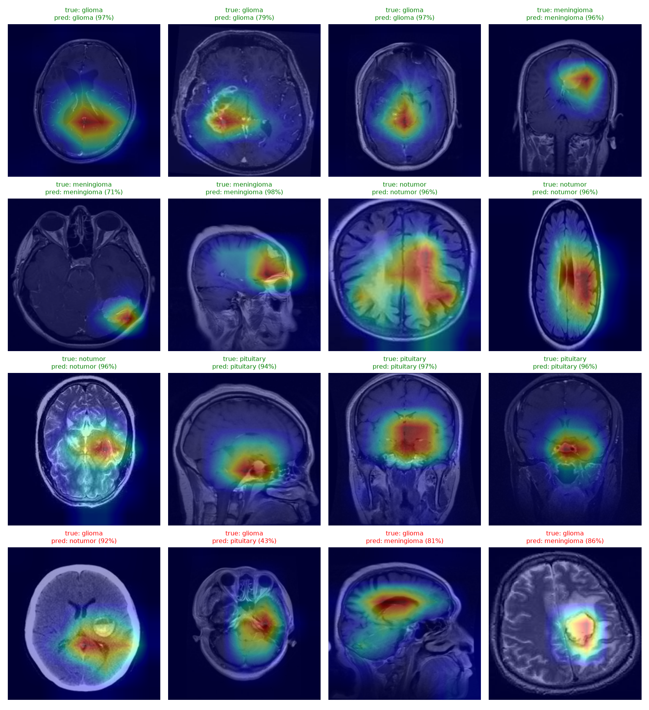

# Brain Tumor MRI Classifier with Grad-CAM

A ResNet50, pretrained on ImageNet and fine-tuned to sort brain MRI slices into **glioma, meningioma, pituitary tumor or no tumor**. Grad-CAM heatmaps show which part of each scan the model relied on.

The more interesting part of the project is what happened after the first model: it scored 95%, but by reading its mistakes I found it had learned a **shortcut**. It was recognising *which source a scan came from* instead of the tumor. Fixing that raised recall on gliomas from an unseen source from **24% to 76%**.


## Results

All three models are scored on the same 1,562 held-out test scans:


| Model | Overall accuracy | Glioma recall | Other-source glioma recall | Gliomas missed as "no tumor" |
|---|---|---|---|---|
| Original (6 epochs, light augmentation) | 97.4% | 90.6% | 23.7% | 20 |
| + strong augmentation (10 epochs) | 97.9% | 94.5% | 55.3% | 8 |
| **+ 38 borrowed other-source gliomas** | **98.0%** | **96.4%** | **76.3%** | **4** |

Confusion matrix of the final model (rows are true labels, columns are predictions):

|  | glioma | meningioma | no tumor | pituitary | recall |
|---|---|---|---|---|---|
| **glioma** | 349 | 8 | 4 | 1 | 96.4% |
| **meningioma** | 9 | 387 | 0 | 4 | 96.8% |
| **no tumor** | 1 | 0 | 399 | 0 | 99.8% |
| **pituitary** | 2 | 2 | 0 | 396 | 99.0% |

### Where the model looks

Grad-CAM on test scans the final model never trained on. Green titles are correct predictions and red titles are mistakes:



In the last row, the glioma predicted as meningioma (86%) has its heat right on the lesion: the model found the tumor but named the wrong type. The glioma predicted as "no tumor" is a CT scan, a kind of image the model never saw in training.

## The shortcut, in one table

Image size works as a fingerprint for which hospital or collection a scan came from:

| Class | Training scans that are 512 × 512 |
|---|---|
| glioma | **100%** (1,400 / 1,400) |
| meningioma | 90% |
| pituitary | 95% |
| no tumor | **1%** (17 / 1,400) |

The original model got 98.5% of 512 × 512 test gliomas right, but only **18.4%** of gliomas from other sources. Almost half of those it called "no tumor", because in training that look meant "no tumor". The tumors in those scans are plainly visible, so the labels are not the problem. The full investigation is in [docs/DOCUMENTATION.md](docs/DOCUMENTATION.md#4-the-glioma-problem-a-shortcut).

## Quick start

```bash
git clone https://github.com/davidvillaseca-rwth/brain-tumor-mri-gradcam.git
cd brain-tumor-mri-gradcam

# 1. PyTorch with CUDA (pick the right command for your machine at pytorch.org)
pip install torch torchvision --index-url https://download.pytorch.org/whl/cu128
pip install -r requirements.txt

# 2. Data (about 157 MB, into ./data)
python download_data.py

# 3. Train the final model (about 5 min on an RTX 3060 laptop GPU)
python train.py --strong-aug --borrow --epochs 10 --out models/resnet50_borrow.pt

# 4. Heatmaps on unseen test scans, or on your own images
python gradcam.py
python gradcam.py path/to/scan.jpg
```

To skip training, download `resnet50_borrow.pt` from the [Releases page](https://github.com/davidvillaseca-rwth/brain-tumor-mri-gradcam/releases) and put it in `models/`.

## Project layout

| File | What it does |
|---|---|
| `download_data.py` | Downloads the Kaggle dataset into `data/` |
| `train.py` | Fine-tunes ResNet50 and reports test accuracy and the confusion matrix |
| `gradcam.py` | Grad-CAM heatmaps for test scans or your own images |
| `analyze_sources.py` | Reproduces the shortcut diagnosis (image size by class, glioma recall by source) |
| `compare.py` | Scores every saved model on the same held-out test set |
| `docs/DOCUMENTATION.md` | Full write-up: data, method, the investigation, limitations |

## Limitations

- **This is a learning project, not a medical device.** Don't use it for diagnosis.
- The benchmark is easy compared with real clinical data. It uses single 2-D slices, mostly from a few public collections, and contains near-duplicate images. Expect lower accuracy on scans from a new hospital.
- The test set was looked at several times while the fix was being developed, and only 38 other-source gliomas remain in it. Read 76% as a clear direction, not an exact figure.

## Credits

- Dataset: [Brain Tumor MRI Dataset](https://www.kaggle.com/datasets/masoudnickparvar/brain-tumor-mri-dataset) by Masoud Nickparvar on Kaggle (built from the figshare, SARTAJ and Br35H collections). See the dataset page for its license. The images are not included in this repository.
- Grad-CAM: Selvaraju et al., *Grad-CAM: Visual Explanations from Deep Networks via Gradient-based Localization*, ICCV 2017.
- ResNet: He et al., *Deep Residual Learning for Image Recognition*, CVPR 2016.
