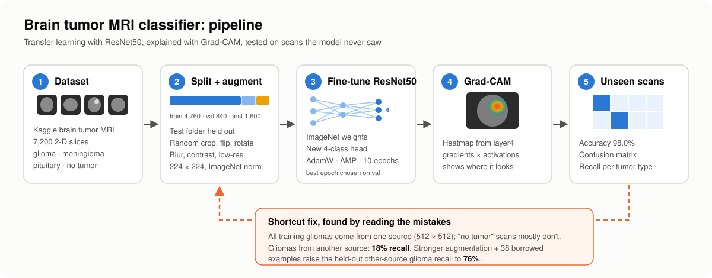
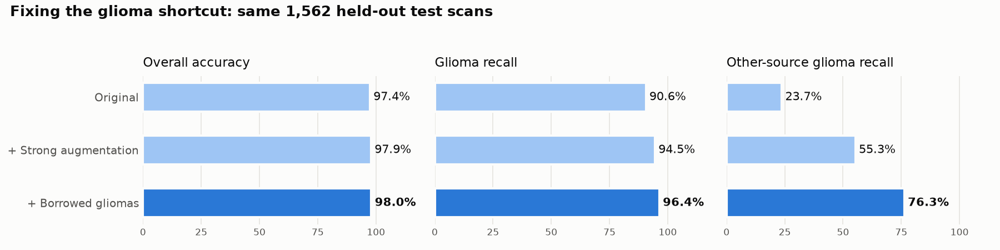

# Brain Tumor MRI Classifier with Grad-CAM

This is a ResNet50, pretrained on ImageNet, that I fine-tuned to sort brain MRI slices into four classes: glioma, meningioma, pituitary tumor and no tumor. Grad-CAM heatmaps show which part of each scan the model used for its answer.

The first model scored 97.4% on the held-out test set (the same 1,562 scans used in the results table), but it missed a lot of gliomas. When I went through its mistakes, it turned out the model had partly learned to recognise which collection a scan came from, and used that as a stand-in for the diagnosis. After fixing that, it gets 76% of gliomas from an unseen source right, up from 24%.



## Results

All three models below were scored on the same 1,562 held-out test scans.



| Model | Overall accuracy | Glioma recall | Other-source glioma recall | Gliomas missed as "no tumor" |
|---|---|---|---|---|
| Original (6 epochs, light augmentation) | 97.4% | 90.6% | 23.7% | 20 |
| + strong augmentation (10 epochs) | 97.9% | 94.5% | 55.3% | 8 |
| + 38 borrowed other-source gliomas | 98.0% | 96.4% | 76.3% | 4 |

Confusion matrix of the final model (rows are true labels, columns are predictions):

|  | glioma | meningioma | no tumor | pituitary | recall |
|---|---|---|---|---|---|
| glioma | 349 | 8 | 4 | 1 | 96.4% |
| meningioma | 9 | 387 | 0 | 4 | 96.8% |
| no tumor | 1 | 0 | 399 | 0 | 99.8% |
| pituitary | 2 | 2 | 0 | 396 | 99.0% |

### Where the model looks

These are Grad-CAM heatmaps on test scans the final model never trained on. Green titles are correct predictions and red ones are mistakes.


In the bottom row, the glioma predicted as meningioma (86%) has its heat right on the lesion, so the model found the tumor and got the type wrong. The glioma predicted as "no tumor" is a CT scan, which the model never saw in training.

## Why glioma recall was low

Image size gives away which hospital or collection a scan came from, and the classes are spread very unevenly across sizes:

| Class | Training scans that are 512 × 512 |
|---|---|
| glioma | 100% (1,400 / 1,400) |
| meningioma | 90% |
| pituitary | 95% |
| no tumor | 1% (17 / 1,400) |

The original model got 98.5% of the 512 × 512 test gliomas right but only 18.4% of the gliomas from other sources. It called almost half of those "no tumor", since in training that kind of image almost always meant no tumor. I checked the scans and the tumors are clearly visible, so the labels aren't the problem. The full investigation is in [docs/DOCUMENTATION.md](docs/DOCUMENTATION.md#4-the-glioma-problem-a-shortcut).

## Quick start

```bash
git clone https://github.com/davidvillaseca-rwth/brain-tumor-mri-gradcam.git
cd brain-tumor-mri-gradcam

# 1. PyTorch with CUDA (pick the right command for your machine at pytorch.org)
pip install torch torchvision --index-url https://download.pytorch.org/whl/cu128
pip install -r requirements.txt

# 2. Data (about 157 MB, into ./data)
python download_data.py

# 3. Train the final model (about 5 min on an RTX 3060 laptop GPU)
python train.py --strong-aug --borrow --epochs 10 --out models/resnet50_borrow.pt

# 4. Heatmaps on unseen test scans, or on your own images
python gradcam.py
python gradcam.py path/to/scan.jpg
```

If you don't want to train it yourself, download `resnet50_borrow.pt` from the [Releases page](https://github.com/davidvillaseca-rwth/brain-tumor-mri-gradcam/releases) and put it in `models/`.

## Project layout

| File | What it does |
|---|---|
| `download_data.py` | Downloads the Kaggle dataset into `data/` |
| `train.py` | Fine-tunes ResNet50 and prints test accuracy and the confusion matrix |
| `gradcam.py` | Draws Grad-CAM heatmaps for test scans or your own images |
| `analyze_sources.py` | Reproduces the image-size check and glioma recall by source |
| `compare.py` | Scores every saved model on the same held-out test set |
| `docs/DOCUMENTATION.md` | The full write-up: data, method, the investigation and limitations |

## Limitations

This is a learning project and shouldn't be used to diagnose anyone.

The benchmark is also easier than real clinical data. Each image is a single 2-D slice, most come from a handful of public collections, and some are near-duplicates of each other. Scans from a new hospital would probably score lower.

I looked at the test set several times while working on the fix, and only 38 other-source gliomas are left in it, so take the 76% as a clear improvement rather than a precise number.

## Credits

- Dataset: [Brain Tumor MRI Dataset](https://www.kaggle.com/datasets/masoudnickparvar/brain-tumor-mri-dataset) by Masoud Nickparvar on Kaggle, built from the figshare, SARTAJ and Br35H collections. Its license is on the dataset page. The images aren't included in this repository.
- Grad-CAM: Selvaraju et al., *Grad-CAM: Visual Explanations from Deep Networks via Gradient-based Localization*, ICCV 2017.
- ResNet: He et al., *Deep Residual Learning for Image Recognition*, CVPR 2016.
