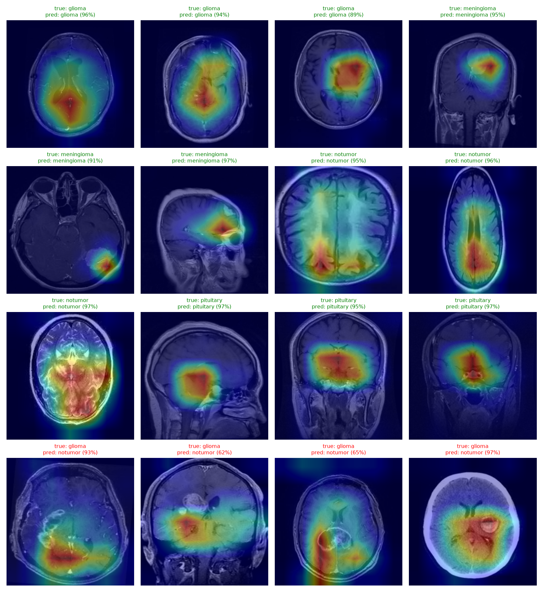
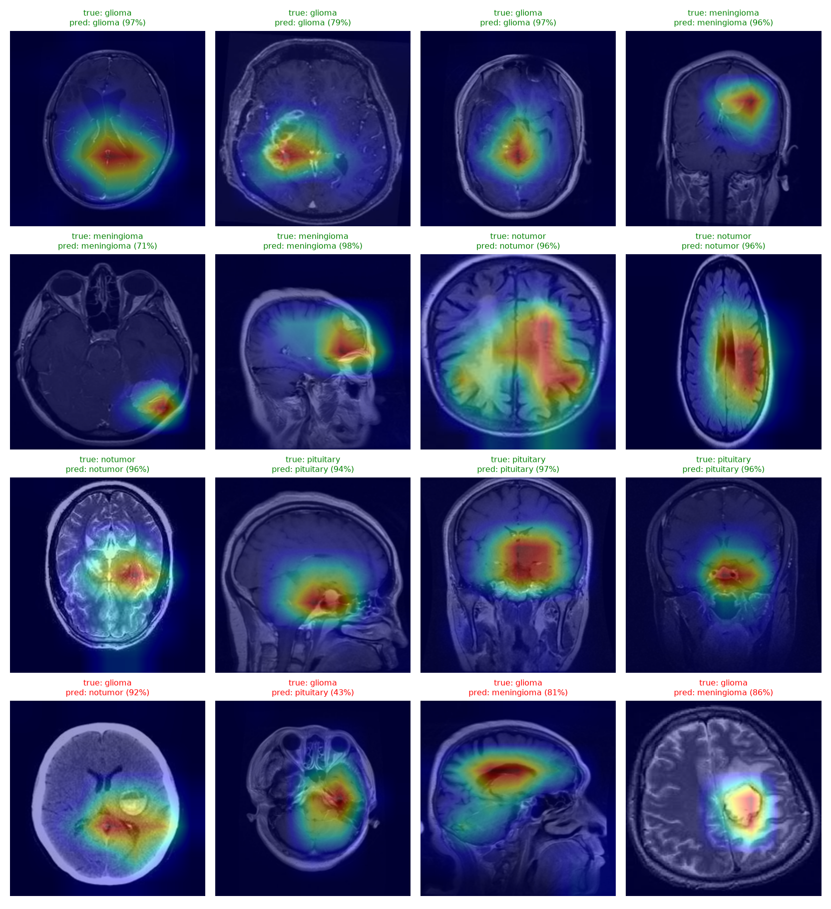

# Detailed documentation

This covers the data, how the model is trained, how the heatmaps are made, how I found and fixed the glioma problem, and how to reproduce every number in the [README](../README.md).

Contents:

1. [Dataset](#1-dataset)
2. [Model and training](#2-model-and-training)
3. [Grad-CAM](#3-grad-cam)
4. [The glioma problem: a shortcut](#4-the-glioma-problem-a-shortcut)
5. [Results](#5-results)
6. [Reproducing everything](#6-reproducing-everything)
7. [Code reference](#7-code-reference)
8. [Limitations and next steps](#8-limitations-and-next-steps)

## 1. Dataset

The data is the [Brain Tumor MRI Dataset](https://www.kaggle.com/datasets/masoudnickparvar/brain-tumor-mri-dataset) from Kaggle: 7,200 JPEGs, each a single 2-D MRI slice, already split into folders.

| Class | Training | Testing |
|---|---|---|
| glioma | 1,400 | 400 |
| meningioma | 1,400 | 400 |
| no tumor | 1,400 | 400 |
| pituitary | 1,400 | 400 |
| Total | 5,600 | 1,600 |

It's a merge of three public collections (figshare, SARTAJ and Br35H), so it mixes axial, coronal and sagittal views and several MRI sequences. Image sizes range from about 200 to 1,400 pixels. Section 4 shows why the mix of sources ended up mattering.

`download_data.py` uses `kagglehub` to put it in `data/`:

```
data/
├── Training/{glioma,meningioma,notumor,pituitary}/*.jpg
└── Testing/{glioma,meningioma,notumor,pituitary}/*.jpg
```

### Splits

| Split | Source | Size | Used for |
|---|---|---|---|
| train | 85% of `Training/` (fixed seed 42) | 4,760 | learning the weights |
| val | the other 15% of `Training/` | 840 | picking the best epoch |
| test | `Testing/` | 1,600 (1,562 for the final model) | the final score only, never for training or picking epochs |

For the final model, 38 images move from `Testing/` into training. Section 4 explains why and how.

## 2. Model and training

### Transfer learning

5,000 images are too few to train a deep network from scratch without overfitting, so `train.py` starts from ResNet50 with ImageNet weights (`IMAGENET1K_V2` in torchvision). Those weights already respond to edges, textures and shapes. I replaced only the last layer, with a new `Linear(2048 → 4)` for the four classes, and then fine-tuned the whole network at a small learning rate so the pretrained features adapt to MRI.

### Preprocessing

Each image is converted to RGB, resized to 224 × 224 and normalised with the ImageNet mean and standard deviation, which is what the pretrained weights expect.

### Augmentation

Augmentation changes each training image at random, so the model has to rely on what stays the same (the tumor) and can't lean on incidental details.

| Transform | Light (original model) | Strong (`--strong-aug`) |
|---|---|---|
| Crop | none | `RandomResizedCrop`, scale 0.6 to 1.0 |
| Low resolution | none | 50% chance: downscale to 96 to 224 px, then upscale again |
| Horizontal flip | yes | yes |
| Rotation | ±10° | ±15° |
| Brightness / contrast | ±20% | ±40% |
| Gaussian blur | none | 30% chance, σ 0.1 to 2.0 |

I added the strong version to work against the source shortcut. Crops, blur and lower resolution blur the differences in sharpness and framing between collections.

### Hyperparameters

| Setting | Value |
|---|---|
| Optimiser | AdamW, weight decay 1e-4 |
| Learning rate | One-cycle schedule, peak 3e-4 |
| Loss | Cross-entropy with label smoothing 0.05 |
| Batch size | 32 |
| Epochs | 6 (original), 10 (strong aug and final) |
| Precision | Mixed (`torch.autocast` + `GradScaler`) |
| Checkpoint | Best validation accuracy |
| Hardware | NVIDIA RTX 3060 Laptop GPU (6 GB), about 28 s per epoch |

Label smoothing keeps the predicted confidence below roughly 95 to 98%. A 96% in the heatmap titles means the model is about as sure as it gets, not that the answer is literally 96% likely.

Each checkpoint stores the weights together with the class order (`{"state_dict": ..., "classes": [...]}`), so the other scripts don't need to hardcode which index is which class.

## 3. Grad-CAM

Grad-CAM ([Selvaraju et al., 2017](https://arxiv.org/abs/1610.02391)) shows which parts of the image pushed the model toward the class it picked. `gradcam.py` implements it in about 15 lines without an extra library:

1. A forward hook on `model.layer4[-1]`, the last convolutional block, saves its output `A`: 2,048 feature maps of 7 × 7.
2. The score of the predicted class, `y_c`, is differentiated with respect to those maps, giving `∂y_c / ∂A`.
3. Averaging each gradient map gives one weight per channel, `α_k`.
4. The heatmap is `ReLU(Σ_k α_k · A_k)`, a weighted sum of the feature maps. The ReLU keeps only the evidence for the class.
5. The 7 × 7 map is upsampled to 224 × 224, scaled to 0 to 1, and drawn over the image with the `jet` colormap.

The model runs in `eval()` mode with gradients still on. I used `torch.autograd.grad` because backward hooks can misbehave with ResNet's in-place ReLUs.

Red areas pushed the prediction the most. The feature map is only 7 × 7, so the heatmaps are blobby: they point at a region and don't trace the tumor's edges.

## 4. The glioma problem: a shortcut

### Symptom

The first model (6 epochs, light augmentation) scored 95.4% on the full test set, but its glioma recall was only 83.3%, and it predicted 36 gliomas as "no tumor", which is the worst mistake it can make here. Validation accuracy, meanwhile, was 99%. A gap that size usually means the test set is different from the training data in some way.

### Diagnosis

Counting image sizes per class (`python analyze_sources.py`) explained it:

```
Share of images that are exactly 512x512 (one source):
  Training glioma      1400/1400  (100%)
  Training meningioma  1267/1400  (90%)
  Training notumor       17/1400  (1%)
  Training pituitary   1328/1400  (95%)
  Testing  glioma       324/400   (81%)
  ...
Test gliomas, predictions of the original model:
  512x512     n=324  correct 98.5%
  other size  n=76   correct 18.4%   meningioma:26  notumor:36
```

Image size tells you which collection a scan came from. In training, every glioma comes from the 512 × 512 source and nearly every "no tumor" scan comes from somewhere else. So the model picked up a cheap rule: if a scan doesn't look like the 512 source, it's probably "no tumor". That rule holds on the training and validation data and breaks on the 76 test gliomas from another collection.

To check whether the labels were wrong, I looked at the other-source gliomas the original model called "no tumor" (`python gradcam.py data/Testing/glioma/Te-gl_129.jpg ...` shows them with heatmaps). Every one has a clearly visible tumor, so the labels are right and the model had learned the wrong cue.

This is called shortcut learning: the model uses a feature that happens to go along with the label in this dataset (here, the collection) in place of the feature that matters.

### Fix 1: strong augmentation

`--strong-aug` (section 2) makes cues like sharpness, resolution and framing unreliable. With the data unchanged, other-source glioma recall went from 23.7% to 55.3%.

### Fix 2: show the model gliomas from other sources

The model had still never seen a glioma from another source, and augmentation can't supply that. `--borrow` does it like this:

1. Find the 76 test gliomas that aren't 512 × 512.
2. Group near-duplicates with an 8 × 8 average image hash. The test folder has copies such as `Te-gl_204` and `Te-gl_259`, and putting one on each side would leak test data into training.
3. Shuffle the groups with a fixed seed and move about half of them, 38 images, into training. Each is repeated 5 times so that 38 images still carry some weight among 4,760, and they get the same augmentation as the rest.
4. Drop those 38 from the test set. `compare.py` then scores every model on the same 1,562 remaining images.

Other-source glioma recall rose to 76.3%, and gliomas missed as "no tumor" on the shared test set fell from 20 to 4.

There's a trade-off. The model now says "glioma" a little more easily: 9 meningiomas are predicted as glioma, and meningioma recall dropped to 96.8%, from 98.3% for the strong-aug model and 98.8% for the original. No meningiomas were borrowed, so all three are measured on the same 400 scans. Mixing up two tumor types is a much smaller problem than missing a tumor, so I kept it.

## 5. Results

### All models on the shared test set (1,562 images)

| Model | Command | Accuracy | Glioma recall | Other-source glioma | Glioma → no tumor |
|---|---|---|---|---|---|
| Original | `train.py --epochs 6` | 97.4% | 90.6% | 23.7% (9/38) | 20 |
| Strong aug | `train.py --strong-aug --epochs 10` | 97.9% | 94.5% | 55.3% (21/38) | 8 |
| Final | `train.py --strong-aug --borrow --epochs 10` | 98.0% | 96.4% | 76.3% (29/38) | 4 |

On the full 1,600-image test set, the original model scored 95.4% and the strong-aug model 96.3%. The shared-set numbers are higher because the 38 borrowed images were among the hardest.

### Final model, confusion matrix (1,562 images)

|  | glioma | meningioma | no tumor | pituitary | recall |
|---|---|---|---|---|---|
| glioma | 349 | 8 | 4 | 1 | 96.4% |
| meningioma | 9 | 387 | 0 | 4 | 96.8% |
| no tumor | 1 | 0 | 399 | 0 | 99.8% |
| pituitary | 2 | 2 | 0 | 396 | 99.0% |

### Heatmaps before and after

Original model:



Final model:



Both grids use the same random seed and show 3 correct scans per class plus the first 4 mistakes found. Test gliomas that were borrowed into training are left out.

## 6. Reproducing everything

```bash
pip install torch torchvision --index-url https://download.pytorch.org/whl/cu128
pip install -r requirements.txt
python download_data.py

# the three models (about 3, 5 and 5 minutes on an RTX 3060 laptop)
python train.py --epochs 6                                   # -> models/resnet50_brain_mri.pt
python train.py --strong-aug --epochs 10 --out models/resnet50_strongaug.pt
python train.py --strong-aug --borrow --epochs 10 --out models/resnet50_borrow.pt

# the analysis and figures
python analyze_sources.py
python compare.py
python gradcam.py --model models/resnet50_brain_mri.pt --out docs/images/gradcam_original.png
python gradcam.py --out docs/images/gradcam_best.png
python docs/make_results_chart.py
```

The data split and the borrowed images are fixed by seeds. GPU training isn't bit-for-bit deterministic, though, so a retrained model will land within a few tenths of a percent of these numbers. `python train.py --smoke` runs in about 30 seconds and is a quick way to check your setup first.

If you only want to run `gradcam.py`, the trained final model is attached to the [GitHub release](https://github.com/davidvillaseca-rwth/brain-tumor-mri-gradcam/releases).

## 7. Code reference

### `train.py`

| Flag | Default | Meaning |
|---|---|---|
| `--epochs N` | 6 | Number of training epochs |
| `--batch N` | 32 | Batch size |
| `--strong-aug` | off | Use the strong augmentation from section 2 |
| `--borrow` | off | Move half of the other-source test gliomas into training (section 4) |
| `--out PATH` | `models/resnet50_brain_mri.pt` | Where to save the best checkpoint |
| `--smoke` | off | 128 training images and 1 epoch, to test the setup |

It prints loss and train/validation accuracy for each epoch, then the test accuracy and confusion matrix of the best checkpoint.

`build_model(n)` returns ResNet50 with an `n`-class head, and `borrow_split(test_ds)` returns the borrowed and kept test indices.

### `gradcam.py`

```bash
python gradcam.py [scans ...] [--model PATH] [--out PATH]
```

With no scans it saves a grid of unseen test scans to `gradcam_grid.png`. With scans it saves your images to `gradcam_custom.png`. The `GradCAM` class works on its own too: `cls, confidence, heatmap = GradCAM(model)(tensor)`.

### `compare.py`

Scores the three checkpoints (whichever exist in `models/`) on the shared 1,562-image test set. It prints overall accuracy, glioma recall, other-source glioma recall and the number of gliomas predicted as no tumor.

### `analyze_sources.py`

```bash
python analyze_sources.py [--model PATH]
```

Prints the share of 512 × 512 images for each split and class, then glioma recall by source group for the chosen model.

## 8. Limitations and next steps

### Limitations

This is an educational project. It hasn't been clinically validated and shouldn't be used to diagnose anyone.

The model sees one 2-D slice at a time. A radiologist reads the whole 3-D volume, several sequences and the patient's history, and a single slice loses most of that.

The benchmark is easier than real hospital data, because it comes from a few public collections and contains near-duplicates. Scans from a new scanner or hospital would probably score lower, for the same reason section 4 describes.

I evaluated the test set several times while working on the fix, and the other-source glioma group is small: 38 images, so each one is worth 2.6 percentage points. The improvement is real, but the exact figure isn't reliable.

Grad-CAM at 7 × 7 shows roughly where the model looks, not where the tumor's borders are. A heatmap in the right place doesn't mean the model reasons the way a doctor does.

At least one test image labelled as MRI is actually a CT scan, and the model doesn't handle CT.

### Next steps

1. Test on a separate public dataset that shares no sources with this one. That would be the best evidence that the model generalises.
2. Remove duplicates across the whole dataset, between training and test, using image hashing, and report the clean score.
3. Add gliomas from other collections to training so the test set doesn't have to supply them.
4. Build a small demo app (Gradio, for example) where you upload a scan and see the prediction and heatmap.
5. Calibrate the confidence scores with temperature scaling, or flag low-confidence scans for a person to review.
